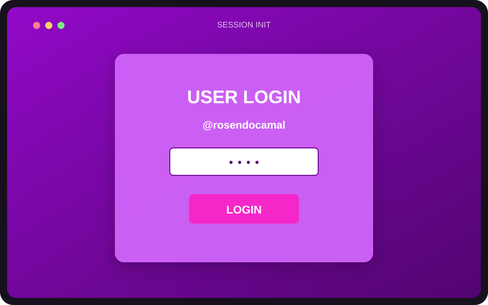
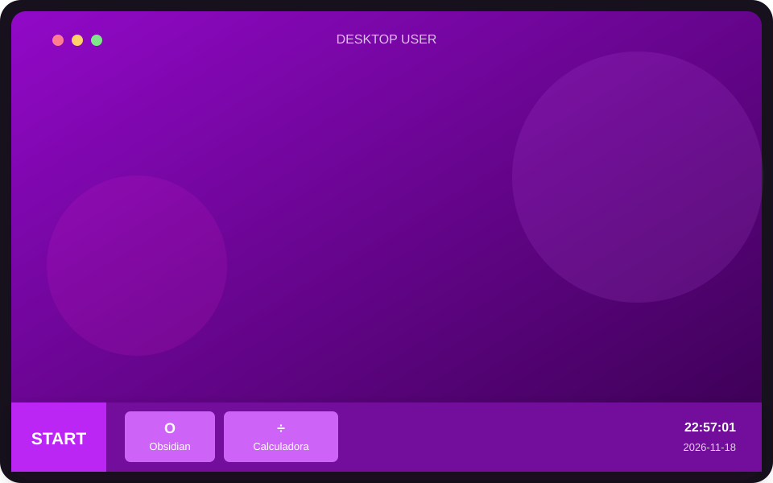
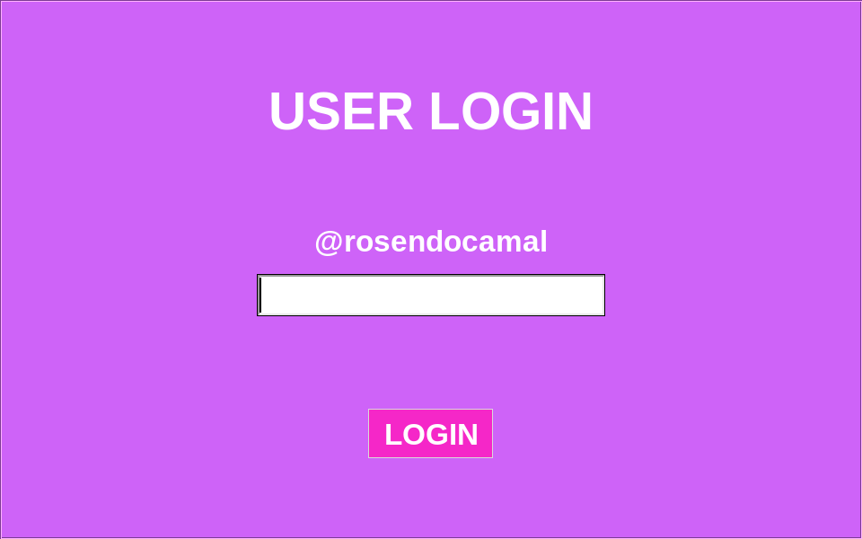
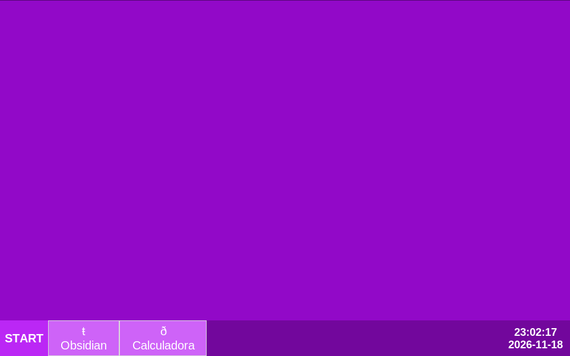

# Desktop with Tkinter

Aplicación que simula un escritorio de computadora con **Python** y **Tkinter**. Incluye una pantalla de inicio de sesión, un escritorio de color morado, una barra de tareas con reloj y un menú de inicio con acciones y accesos a aplicaciones.

> [!WARNING]
> Este proyecto es una demostración, no un sistema operativo ni una herramienta de autenticación segura. La contraseña está escrita directamente en el código (`1234`). Además, las opciones **REBOOT** y **POWER OFF** ejecutan comandos reales del sistema (`reboot` y `shutdown now`); no las selecciones en una computadora que no quieras reiniciar o apagar.

## Diseño conceptual

Estos bocetos SVG representan una propuesta visual previa a la implementación. Son conceptos, no capturas ni una descripción exacta de la interfaz actual. Se guardan separados de las capturas en `.github/assets/concept/`.

<p align="center">
  
</p>
<p align="center"><em>Concepto previo: inicio de sesión</em></p>

<p align="center">
  
</p>
<p align="center"><em>Concepto previo: escritorio y menú de inicio</em></p>

## Vista previa de la implementación

Las imágenes siguientes son capturas de la interfaz ejecutada desde `desktop.py`.

<p align="center">
  
</p>
<p align="center"><em>Pantalla de inicio de sesión</em></p>

<p align="center">
  
</p>
<p align="center"><em>Escritorio con menú de inicio, accesos y reloj</em></p>

## Funcionalidades

- Pantalla de inicio de sesión con campo de contraseña.
- Escritorio simulado con barra de tareas, fecha y reloj actualizados cada segundo.
- Menú de inicio con opciones para cerrar sesión, reiniciar y apagar.
- Accesos directos para abrir Obsidian y la calculadora de GNOME.
- Ejercicios independientes para practicar widgets, eventos, diálogos y gestores de geometría en Tkinter.

## Requisitos

- Python **3.10 o posterior**.
- Tkinter, incluido con muchas instalaciones de Python. En algunas distribuciones de Linux se instala por separado; en Debian o Ubuntu puedes instalarlo con `sudo apt install python3-tk`.
- Obsidian instalado mediante Flatpak y GNOME Calculator son opcionales: solo se necesitan para que funcionen esos accesos directos.

El proyecto usa comandos y aplicaciones propias de Linux para abrir los accesos, reiniciar y apagar. En otros sistemas operativos, esas opciones pueden no funcionar.

## Instalación y ejecución

Clona el repositorio y ejecuta la aplicación:

```bash
git clone https://github.com/rosendocamal/desktop-with-tkinter.git
cd desktop-with-tkinter
python3 desktop.py
```

No se necesitan paquetes de Python de terceros para iniciar la aplicación principal.

## Uso

1. Escribe `1234` en el campo de contraseña y pulsa **LOGIN**.
2. Usa el menú **START** para ver las opciones disponibles.
3. Pulsa los accesos de Obsidian o Calculadora para abrir esas aplicaciones, si están instaladas.

> [!CAUTION]
> **REBOOT** y **POWER OFF** pueden reiniciar o apagar el equipo. La aplicación no simula esas acciones: ejecuta comandos del sistema.

## Ejercicios

La carpeta `exercises/` contiene ejemplos pequeños que se pueden ejecutar por separado desde la raíz del proyecto. Incluye prácticas de:

- Fundamentos y widgets, como botones, etiquetas y campos de entrada.
- Gestores de geometría `pack`, `grid` y `place`.
- Menús, diálogos y eventos.
- Recursos gráficos de ejemplo.

Por ejemplo:

```bash
python3 exercises/hello.py
```

## Tecnologías

- **Python 3.10+**
- **Tkinter** para la interfaz gráfica

## Licencia

Este proyecto se distribuye bajo la licencia MIT. Consulta el archivo [LICENSE](LICENSE).

## Autor

Proyecto desarrollado por **Rosendo Camal**.

- [GitHub](https://github.com/rosendocamal)
- [LinkedIn](https://www.linkedin.com/in/rosendocamal)
